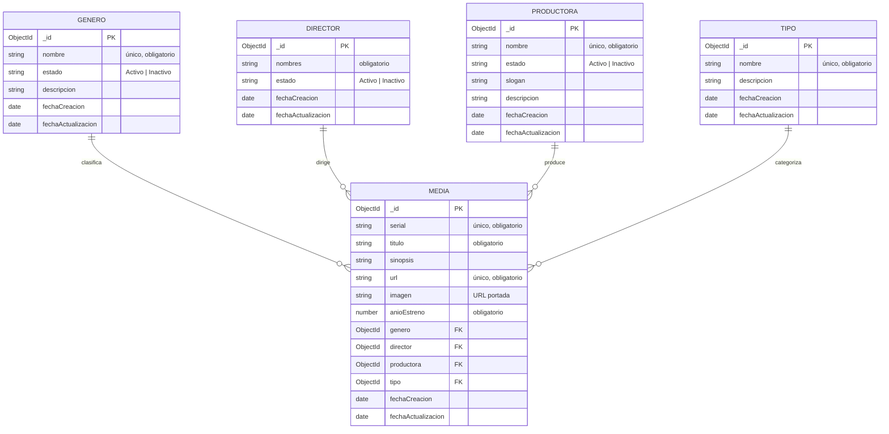

# API REST Películas – IU Digital (Ingeniería Web II)

API REST en **Node.js + Express + MongoDB (Mongoose)** para administrar el catálogo de una plataforma de películas y series "tipo Cuevana". Cubre los cinco módulos del caso de estudio: **Género, Director, Productora, Tipo y Media**.

## 1. Diseño de la base de datos

Base de datos documental (MongoDB) con 5 colecciones. `Media` referencia a las otras cuatro mediante `ObjectId` (relación 1 a muchos: un género, director, productora o tipo puede estar en muchas medias; cada media tiene **uno solo** de cada uno).



`fechaCreacion` y `fechaActualizacion` las gestiona Mongoose automáticamente (`timestamps`).

### Reglas de negocio implementadas

| Regla del caso de estudio | Implementación |
|---|---|
| Serial y URL de la media son únicos | Índice `unique` → responde **409** si se repiten |
| La media solo admite géneros, directores y productoras **activos** | Se valida en POST y PUT → **400** si está inactivo o no existe |
| El tipo debe existir en el módulo Tipo | Se valida en POST y PUT → **400** |
| Un único género / director / productora / tipo por media | Campo `ObjectId` simple (no arreglo) |
| Géneros iniciales: acción, aventura, ciencia ficción, drama, terror; tipos: serie y película | Script `npm run seed` |
| Integridad referencial | No se puede eliminar un género/director/productora/tipo usado por alguna media → **409** (se sugiere inactivarlo) |

## 2. Estructura del proyecto

```
src/
├── index.js                 # Arranque: conexión a BD + servidor
├── app.js                   # Configuración de Express (cors, json, rutas, errores)
├── config/db.js             # Conexión a MongoDB
├── models/                  # Esquemas Mongoose (Genero, Director, Productora, Tipo, Media)
├── controllers/
│   ├── crudController.js    # CRUD reutilizable para los 4 catálogos
│   └── mediaController.js   # CRUD de Media + validación de relaciones activas
├── routes/                  # Rutas REST de cada módulo
├── middlewares/             # Validaciones (express-validator) y manejo de errores
└── seed/seed.js             # Datos iniciales
postman/API_Peliculas.postman_collection.json
```

## 3. Instalación y ejecución

Requisitos: Node.js 18+ y MongoDB (local o [MongoDB Atlas](https://www.mongodb.com/atlas) gratuito).

```bash
npm install
cp .env.example .env      # ajuste MONGO_URI si usa Atlas
npm run seed              # (opcional) carga géneros y tipos iniciales
npm run dev               # desarrollo con nodemon  |  npm start en producción
```

Servidor: `http://localhost:4000`

## 4. Endpoints

Base: `http://localhost:4000/api`

| Módulo | Recurso |
|---|---|
| Género | `/generos` |
| Director | `/directores` |
| Productora | `/productoras` |
| Tipo | `/tipos` |
| Media (películas y series) | `/medias` |

Cada recurso expone las mismas operaciones:

| Método | Ruta | Acción | Respuesta OK |
|---|---|---|---|
| GET | `/recurso` | Listar todos | 200 |
| GET | `/recurso/:id` | Obtener uno | 200 |
| POST | `/recurso` | Crear | 201 |
| PUT | `/recurso/:id` | Actualizar (parcial) | 200 |
| DELETE | `/recurso/:id` | Eliminar | 200 |

**Filtros:**
- Género, Director, Productora: `?estado=Activo` o `?estado=Inactivo`
- Media: `?titulo=texto&anio=2010&genero=<id>&director=<id>&productora=<id>&tipo=<id>`

Las consultas de Media devuelven género, director, productora y tipo **poblados** (con su nombre), no solo el id.

### Ejemplos de cuerpo (JSON)

```jsonc
// POST /api/generos
{ "nombre": "Acción", "estado": "Activo", "descripcion": "Escenas de alto impacto" }

// POST /api/directores
{ "nombres": "Christopher Nolan", "estado": "Activo" }

// POST /api/productoras
{ "nombre": "Warner Bros", "estado": "Activo", "slogan": "The stuff that dreams are made of", "descripcion": "Estudio estadounidense" }

// POST /api/tipos
{ "nombre": "Película", "descripcion": "Producción de una sola pieza" }

// POST /api/medias
{
  "serial": "MOV-001",
  "titulo": "Inception",
  "sinopsis": "Un ladrón que roba secretos a través de los sueños.",
  "url": "https://peliculas.iudigital.edu.co/inception",
  "imagen": "https://peliculas.iudigital.edu.co/img/inception.jpg",
  "anioEstreno": 2010,
  "genero": "<id género activo>",
  "director": "<id director activo>",
  "productora": "<id productora activa>",
  "tipo": "<id tipo>"
}
```

### Códigos de error

| Código | Cuándo |
|---|---|
| 400 | Datos faltantes o inválidos, id mal formado, género/director/productora inactivo |
| 404 | Registro o ruta no encontrados |
| 409 | Valor único repetido (serial, url, nombre) o eliminación de un registro en uso |
| 500 | Error interno |

Formato: `{ "ok": false, "mensaje": "...", "errores": [{ "campo": "...", "mensaje": "..." }] }`

## 5. Pruebas con Postman

1. En Postman: **Import** → `postman/API_Peliculas.postman_collection.json`.
2. La variable `baseUrl` ya apunta a `http://localhost:4000/api`.
3. Ejecute las carpetas **en orden** (o toda la colección con *Run collection*): cada "Crear" guarda el id en una variable y las siguientes peticiones lo reutilizan. Incluye casos de error (duplicados, género inactivo, eliminar registro en uso).

Resultado esperado: 35 peticiones, 36 aserciones, 0 fallos.
